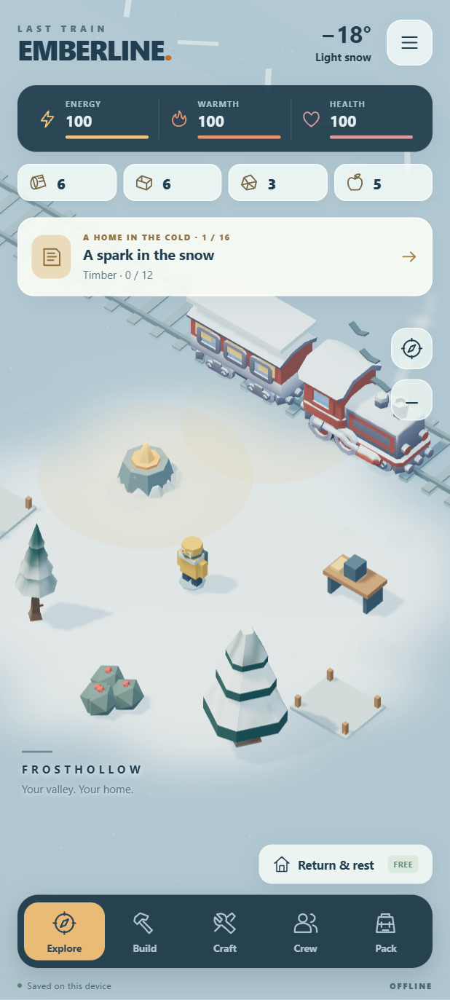

# Emberline

An original offline Android survival adventure. The rails end in **Frosthollow**, and the train becomes your permanent home. Explore one continuous snowy valley, gather supplies, craft equipment, rescue a crew, and build a settlement that stays with you.

**Version 0.2.0 is a playable preview.** The signed APK and source are available in Releases. It has passed model, browser/touch, and Android 15 emulator checks, including airplane-mode launch, gathering, crafting, save restoration, and native backup export/import. Audio, sustained GPU performance, battery use, and device-specific behavior still need physical-phone verification. The requested target is the Galaxy S24 Ultra.



## A game you earn by playing

- One continuous valley and a stationary train. No zone transitions, relocation, or forced base reset.
- 16 story milestones, three recruitable specialists, wildlife, changing weather, and a persistent fog-of-war map.
- Bundled Kenney CC0 locomotives, coach, wagon, varied pines, rocks and camp props, with winter shading, warm windows, original decorations and an illustrated title. Soft exploration fog, swaying trees, wind-driven snow, chimney smoke, fire embers and fading footprints.
- Earned upgrades add a porch, wagon, lamps, bunting and building details. Rescued crew carry supplies; birds and a snow hare add life; tracks hint at a nearby secret.
- Original procedural music gains layers as home grows, with local wind, fire, engine ambience and material-specific effects. Audio and music have separate controls.
- Five settlement buildings with three levels each, and five equipment items with three levels each.
- Eight hidden keepsakes, an original mystery trail, and a final secret vault.
- 25 achievements and six locomotive paint schemes earned through gameplay.
- Repeatable gathering, crafting, survey, and single-outing contracts. New games use different contract seeds; requests increase with completed contracts.
- Three difficulty choices. All content is available on every difficulty, and you can change difficulty in Settings.
- Local autosave, a backup save, and JSON export/import. Time stops in menus and while the Android app is paused.
- No purchases, ads, accounts, tracking, paid currency, daily-login gates, or server. The APK requests **no permissions**, including no INTERNET permission.

The campaign ends with the beacon; the valley remains playable for contracts, secrets, achievements, and upgrades. Repeat contracts reuse this valley and four objective families; they are not new story chapters or procedurally generated worlds.

## Install and play

1. Download `Emberline-0.2.0.apk` onto the phone and open it from My Files or the browser's download list.
2. If Android asks, allow that app to install this APK. Accept the Emberline installation prompt.
3. Update an existing installation directly; do not uninstall it if you want to keep its private save.
4. Open Emberline, choose a difficulty in the field guide, and tap **Let’s make a home**.

Requires Android 10 or newer and Android System WebView with WebGL2 support. There are no native ABI-specific libraries in the APK. A modern WebView is required; if rendering is unavailable, the app shows a message instead of overwriting progress. Update an existing installation with the same package and signing identity to keep saves. Uninstalling deletes app-private saves, so export a backup first.

Tap snow to walk; drag to pan. Tap an object and its action button to gather, rescue, or restore. Use Craft and Build for improvements, Crew for companions and crops, and Pack for food or medicine. Tap the quest card for Story, Contracts, Secrets, and Badges. Return & rest is always available, even without food. The compass recenters the camera; the plus/minus button changes zoom.

## What changed in 0.2.0

The new art pass adds 16 curated CC0 models, an original title illustration, winter surface shading, smoother exploration fog and softer exposure. Earned building upgrades now decorate the same permanent settlement. Crew work routines, birds, a hare and its tracks, fire embers and additional chimney smoke bring the valley to life. An original local musical arrangement and layered ambience grow with the settlement; music has its own switch.

The 0.1.x save format and signing identity are retained. Existing progress resumes on update. Optional art loading is bounded and falls back to the original scene if files cannot load. All 38 web assets are packaged locally. This APK is 3,067,448 bytes (about 3.1 MB).

## Startup and movement fixes retained from 0.1.1

- Fixed the endless “Waking up Frosthollow…” screen: the Windows packaging step now canonicalizes nested asset ZIP paths before signing. The renderer dependency is bundled and can be opened by Android.
- Added early startup diagnostics and a retry button, including Android/WebView version details.
- Fixed Android 15 system-bar spacing by resizing the WebView viewport.
- Added tree sway, wind-responsive snowfall and steam, smooth storm lighting, fading snow footprints, and walking animation for camp residents. Battery saver reduces snow density. Footprints are a bounded cosmetic trail and are not persisted across launches.

The APK bundles its illustration, models, texture, renderer and game code. Sound and music are synthesized locally. No extra download is required. Optional model failures fall back to the original playable scenery, with a message to retry.

## Development

The game is JavaScript/three.js rendered in a local Android WebView, inside a small Java Activity. All HTML, JavaScript, styles, and licenses are APK assets served through an app-owned intercepted HTTPS origin. External navigation is blocked, file access is disabled, and no network permission is declared. There is no production HTTP server.

With Node.js 22+:

```sh
npm ci --ignore-scripts
npm run vendor
npm test
npm run serve
```

Open the loopback preview URL printed by the server. For browser QA, keep that server running and run:

```sh
node tests/browser-smoke.mjs
node tests/touch-flow.mjs
node tests/replay-ui.mjs
node tests/startup.mjs
node tests/art-audio.mjs
python tests/package-apk.test.py
```

The art/audio check includes explicitly constructed upgraded and storm fixtures; these are visual tests, not evidence of completing the campaign through touch controls.

Set `CHROME_PATH` to your Chrome/Chromium executable if necessary. Tests launch a separate headless browser and write reports/screenshots under ignored `build/`. Browser tests do not substitute for Android device testing.

### Android build

The build script uses the standard SDK pipeline directly: AAPT2 → javac → D8 → canonical ZIP packaging → ZIP alignment → signing. It requires Python 3, JDK 17, Android platform 31 stubs, and build-tools 35.0.0. The manifest declares minSdk 29 and targetSdk 35. No Gradle download or runtime network dependency is needed.

```powershell
# Supply your own private signing identity; do not commit it.
$env:EMBERLINE_STORE_PASS = <password supplied securely in your session>
./scripts/build-android.ps1 `
  -JdkHome <jdk-directory> `
  -AndroidJar <sdk-platform-directory/android.jar> `
  -BuildTools <sdk-build-tools-directory> `
  -KeyStore <private-signing-keystore> `
  -KeyAlias <your-keystore-alias>
$env:EMBERLINE_STORE_PASS = $null
```

The output is `build/Emberline-0.2.0.apk`. The script verifies raw ZIP paths, CRCs, the APK signature, and alignment. Nested asset paths must use forward slashes; Python on Windows can conceal raw backslashes in ZipInfo.filename, so validation uses orig_filename. A fresh staging directory prevents stale class files entering subsequent builds. Private release keys and passwords are never included in the source archive.

Game rules: `web/model.js`. Content: `web/content.js`. Rendering: `web/world.js`; models and living scenery: `web/art.js`. Touch/UI/save orchestration: `web/main.js`. Original procedural sound: `web/audio.js`. Android wrapper: `android/src/com/seanshaffer/emberline/MainActivity.java`.

See [validation](docs/VALIDATION.md) and [third-party notices](THIRD-PARTY-NOTICES.md). Original project code is MIT licensed; Kenney models/textures are CC0. Asset provenance and applicable notices are retained.

## Design and implementation references

The original request referenced the broad loop described on [Train of Hope's official listing](https://play.google.com/store/apps/details?id=com.samfinaco.tos), and the frozen survival atmosphere of [Frost World's official listing](https://apps.apple.com/ca/app/frost-world-winter-survival/id6738846199). Emberline's fixed settlement, characters, story, secrets and rules were created for this project. Models adapted from Kenney's CC0 packs are credited in THIRD-PARTY-NOTICES.md.

The project consulted the [shared development catalog](https://github.com/SeanShaffer88/useful-dev-resources), [three.js documentation](https://threejs.org/docs/), and [Android's bundled-content guidance](https://developer.android.com/develop/ui/views/layout/webapps/load-local-content) on 2026-10-22. Native Canvas and Godot were considered; locally bundled three.js fit the available toolchain, 3D rendering, and touch-testing workflow. The tradeoff is dependence on the device's WebView/GPU implementation.
