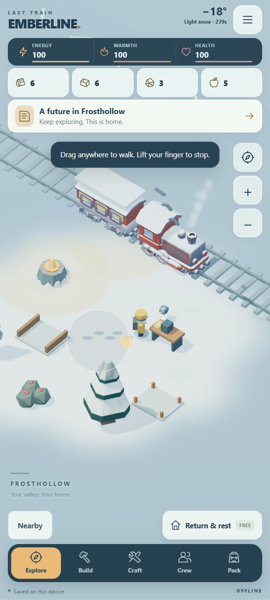
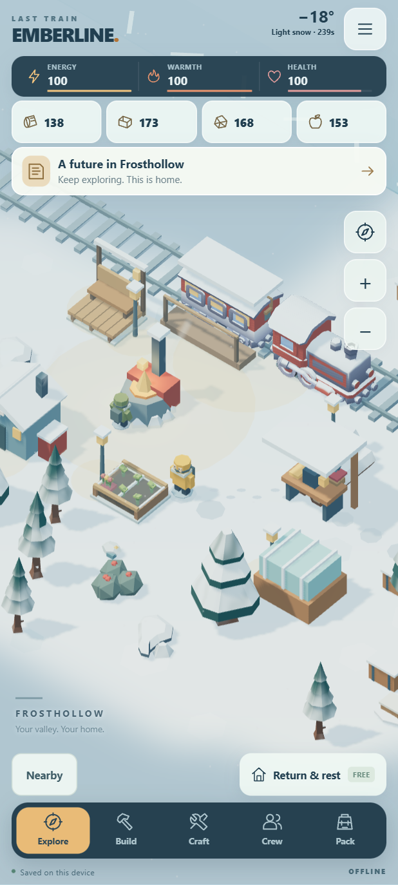

# Freedom and discovery preview

Source-only development milestone, 2026-10-23, on `feature/play-feel`. No APK was built, signed, uploaded or released. Package identity, signing configuration and version remain unchanged. The published 0.2.0 APK does not contain these changes.

## Movement

Drag from anywhere on open play space to steer. Direction follows the drag; a short drag walks more slowly, a longer drag reaches full speed. Lift to stop exactly where you are. Movement is continuous in all directions with collision sliding, rather than grid stepping. The small transient direction guide appears only while dragging. There is no fixed joystick or tap-to-walk.

Use two fingers to pan or pinch the camera. The last finger after a pinch cannot accidentally start walking. Mouse users can pan with right/middle drag or Shift-drag, and use the wheel to zoom. WASD/arrows also steer continuously. The compass resumes follow. Taps select objects; an interaction button still offers automatic approach. Starting a drag cancels approach or gathering without snapping back to a grid tile. Menus, cancellation, blur and Android pause stop manual controls.

The directional drag reference was the movement description in [this Hunt Royale review](https://thecasualappgamer.com/hunt-royale/). Emberline retains its own gathering and survival systems; this is not an implementation or measurement of Hunt Royale's internal controls.

## The ten additions

| Improvement | Implemented behavior |
| --- | --- |
| 1. Nearby-object selection | Overlapping ray hits open a named chooser. The Nearby button lists visible objects and people within 3.5 paces. |
| 2. Continuous gathering | Gather remaining supplies repeats one selected deposit. It stops when depleted, cancelled, interrupted by a menu/story, or before energy drops below a five-point reserve. Warmth and health thresholds also prevent another cycle. |
| 3. Gathering finishes | Timber chips, coal fragments, salvage chips and berries burst out, then collect toward the explorer. Distinct finish sounds, inventory pulses and surface footsteps are synthesized locally. Haptics default off; choose Finish only or All strikes. |
| 4. Environmental puzzles | Three visitors, The quiet chimes and A reply in brass have visible marks, written clues, saved partial progress, free retries and one-time rewards. The brass mechanism requires the restored signal post. Three decoration designs are unlocked. Audio is optional. |
| 5. Settlement decoration | Eleven designs earned from restoration, friendship, puzzles and outings. Craft each once, then place/reuse it at four spots beside the existing settlement. Four colour palettes; free placement/removal; no travel lanes are blocked. |
| 6. Friendship requests | Two requests each for Mira, Oren and Ivo, tied to their rescue and restoration milestones. Stories remain readable. Completing a friendship unlocks a design plus reduced cold exposure, an extra plank per crafting batch, or less storm slowdown. No relationship decay or timed gifts. |
| 7. Weather discoveries | Forecasts show active-play time until the next weather change. Shelter and clothing affect cold/travel. Each of three drifts can reveal one supply bundle per completed natural storm cycle. Personal challenge storms cannot farm extra cycles. |
| 8. Familiar wildlife | Thimble the hare, Ember the fox and Pip the snowbird can be observed nearby. Small routines and journal notes give them identities; placing a crafted feeder changes Pip's perch. No upkeep or feeding penalties. |
| 9. Packed snow trails | Repeated tile visits gradually leave permanent, bounded packed-snow patches. They survive saves and change footstep sounds. The existing short-lived individual footprints remain too. |
| 10. Optional outings | Back to hand tools, A careful outing and The white walk provide different constraints and repeatable supply rewards. First completion teaches the pennant design. Leave freely; settlement and earned gear stay intact. Existing contracts also remain available. |

Find these systems through the forecast button or Journal → Valley. Build links to decoration; Crew links to personal requests. Progress timers and new wildlife routes use active play. Menus and application pause freeze progression; cosmetic snow and idle animation may continue behind a menu. No wall-clock catch-up, advertisements, purchases, services, inference models or new runtime downloads.

## Saves and assets

Save format version 1 is retained with optional extension fields. Old saves receive empty new progress and haptics off. Fractional player coordinates survive export/import. Original resource IDs and positions are unchanged; new sites are appended. New story choices, designs, placements, palette, friendships, puzzle progress, observations, trail counts, storm claims and active challenge progress are stored locally.

The new props, animals, puzzle mechanisms, decorations and pooled collection particles are original code-generated meshes in `web/journey-art.js` and `web/finish-fx.js`. New tones and surface sounds are original synthesis in `web/audio.js`. No new external asset pack or dependency was adopted; previous bundled model provenance and licenses remain in the asset manifest and third-party notices. Tree fading still restores and disposes isolated material copies.

Android feedback uses `View.performHapticFeedback`, with system touch settings respected and no permission added, following [Android's haptic feedback documentation](https://developer.android.com/develop/ui/views/haptics/haptic-feedback). The browser fallback uses short vibration requests when supported. Neither path guarantees that every device/browser will emit a vibration.

## Validation and limits

- 34 model/asset test groups passed, including the original 16-step campaign and 100-contract economy, continuous collision movement, all puzzles, six requests, all three outing types, save migration and bounded imported progress.
- Nine browser suites passed: startup, general UI, touch flow, replay UI, art/audio, play feel, living valley, freedom, and overlapping selection. They cover real Chromium touch drags, lift/cancel/menu/pinch transitions, camera continuity, gathering interruption, earned content UI, local saves, deliberately overlapping rendered-object selection, haptic setting choices, and offline gameplay after assets load. No external runtime requests were observed.
- Supplied inventory and completed-restoration fixtures isolate the new content UI; puzzle and challenge approach fixtures use legal model steps. These are not a claim that the entire expanded game was completed through touch controls.
- Small portrait and landscape layouts were inspected. Screenshots show actual locally rendered assets; the developed-camp image uses an explicitly progressed fixture.
- The native Activity compiled with JDK 17 against Android platform 31 stubs, with expected Java 8 bootstrap/deprecation warnings. Only class files were produced; there was no Android packaging or signing.
- No new emulator or physical Galaxy S24 Ultra test was performed. Sustained phone performance, audible mix, haptic feel and thumb ergonomics remain to be tested on a future authorized APK.

The existing release APK remains 3,067,448 bytes with SHA-256 `fe7d6e8a1df895fc36f091d2beb082049b264591c2ecf054aa405650615221cf`.

