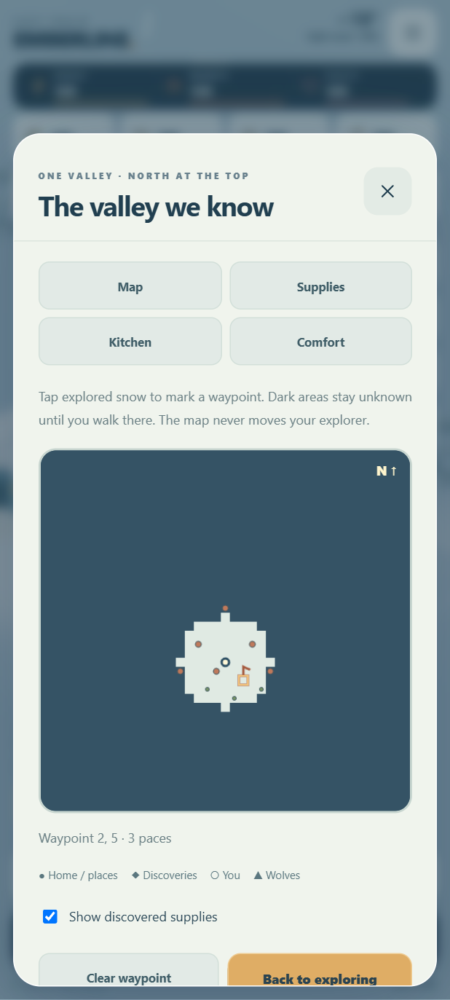

# Hearth & Horizon

Source-only preview, 2026-10-23, on `feature/play-feel`. No APK was built, signed or released. The native wrapper, package identity, signing configuration and published 0.2.0 APK remain unchanged.

## Six additions

This document records source milestone `9927687`. The current preview is documented in [Small Wonders](SMALL-WONDERS.md).

1. **An exploration map and waypoints.** The folded-map button opens a local map of the same valley. Unexplored terrain stays dark; secrets and restoration discoveries only appear after being noticed in the world. Home is always known. Discovered supplies can be shown separately; wolves use a distinct warning marker. Tap explored terrain, choose a familiar place, or use arrow keys and Enter to mark a waypoint. Its flag and distance appear in the valley. Marking never moves the explorer or reveals terrain. Clear it from the map whenever you like.

2. **Pinned supplies.** Open the planner through Build, Craft or the valley overview. Choose a recipe batch, the next building level, an equipment level or a restoration stage. The existing quest card becomes a live supplies list, so the HUD does not take more space from the world. Partial crafting reduces the remaining ingredients; finishing marks the original target complete. Pinning spends nothing and never performs an action automatically. The planner can locate discovered raw supplies or open Craft for manufactured ingredients. Unpin to restore the story card.

3. **The camp kitchen.** Cook and eat near the hearth. Trail stew requires the restored hearth; pine-tip tea also requires the first garden stage; pocket oatcakes also require a greenhouse. All ingredients are earned in the valley. Each meal restores some energy/warmth immediately and grants a three-minute active-play benefit. Only one benefit can be active, with a clearly labelled replacement button. Stored ingredients never spoil.

   | Meal | Ingredients | Immediate recovery | Temporary benefit |
   | --- | --- | --- | --- |
   | Trail stew | 3 food, 1 coal | 20 energy, 20 warmth | Gathering costs 2 energy instead of 3 |
   | Pine-tip tea | 1 food, 1 coal | 30 warmth | 35% less cold exposure |
   | Pocket oatcakes | 3 food, 1 timber | 30 energy | 12% faster walking |

4. **Gentle daylight, evening and moonlight.** A twelve-minute active-play cycle shifts the ambient light, sky tint and sun colour. Lamps, windows and warm pools of light become more prominent after dusk. The snow and paths remain visible. This is a visual cycle; it adds no darkness damage, locked content or real-world waiting. Weather retains its separate rules.

5. **Comfort controls.** Settings → Comfort offers Gentle, Normal and Responsive drag sensitivity. These change how far the thumb travels to reach full walking speed, without raising the maximum speed. Reduced motion removes drifting snow/steam, gathering particles, tree sway, character bobbing and interface animations while retaining necessary walking and work poses. Steady daylight keeps daytime lighting without changing weather, difficulty or rewards. Preferences persist locally.

6. **Photo mode.** Enter through Comfort. Survival, meals, progress time and ambient animation pause; the HUD disappears and the camera uses the full screen. One finger pans in this mode, two fingers pan/zoom, and the buttons offer zoom adjustments. Hide controls for a clean frame, then tap the view to recover them. Use the device's screenshot controls to save the picture. Back to game, Escape or the Android Back hook restores gameplay and the previous zoom/follow preference. Photo framing does not change the saved gameplay zoom.

## Continuity and offline behavior

The valley layout, original resource IDs, existing restorations, inventory and progression are unchanged. New map, goal and meal data are optional save-format-1 fields, so older saves migrate without resetting the settlement. Missing comfort settings default to normal sensitivity, the day cycle and ordinary animation. Imported values are checked against known recipes, goal types, map bounds and duration limits.

Meals expire through simulation ticks, not wall-clock time. Menus, closing the application and photo mode stop their timers. There is no online map, download, login, purchase, daily reward or background catch-up. The map, lighting, interface and folded-map icon are original code/SVG; no new asset pack, service, dependency or permission was introduced.

## Screenshots

The menu screenshots and moonlight view come from a supplied-progress browser fixture, not a claimed full playthrough of the expanded game. The small explored area in the map is intentional: upgrading a fixture does not automatically reveal terrain.

## Validation and limits

- All 42 model/asset test groups passed, covering old-save migration, bounded imported progress, exploration privacy, goal costs, meal prerequisites/expiry/effects, and the original campaign and repeatable economy.
- Ten Chromium browser suites passed: general UI, touch flow, replay UI, startup recovery, art/audio, play feel, living valley, overlapping selection, freedom, and Hearth & Horizon. The new suite exercises actual map taps, recipe pinning and crafting, three meal buttons, real drag sensitivity, photo panning/pinch/hide/recover/exit, pause/resume and Back hooks, and offline menu actions after asset loading. No external runtime requests or JavaScript errors were observed.
- Small portrait and landscape views were inspected. The landscape map fits inside the visible sheet; keyboard cursor selection is also available. Moonlight, the map and kitchen were inspected in rendered screenshots.
- Photo mode freezes survival, meals and world animation, suppresses transient HUD notifications, and restores normal gameplay zoom. Progressed inventory/lighting fixtures isolate these checks; they are not a complete touch playthrough.
- The Android wrapper was not changed, compiled, packaged or signed during this pass. No emulator or physical Galaxy S24 Ultra testing was performed. Phone performance, audible mix, haptics and thumb ergonomics still need a future device playtest.

The published APK remains 3,067,448 bytes, SHA-256 `fe7d6e8a1df895fc36f091d2beb082049b264591c2ecf054aa405650615221cf`. These additions are in the source/browser preview only.
