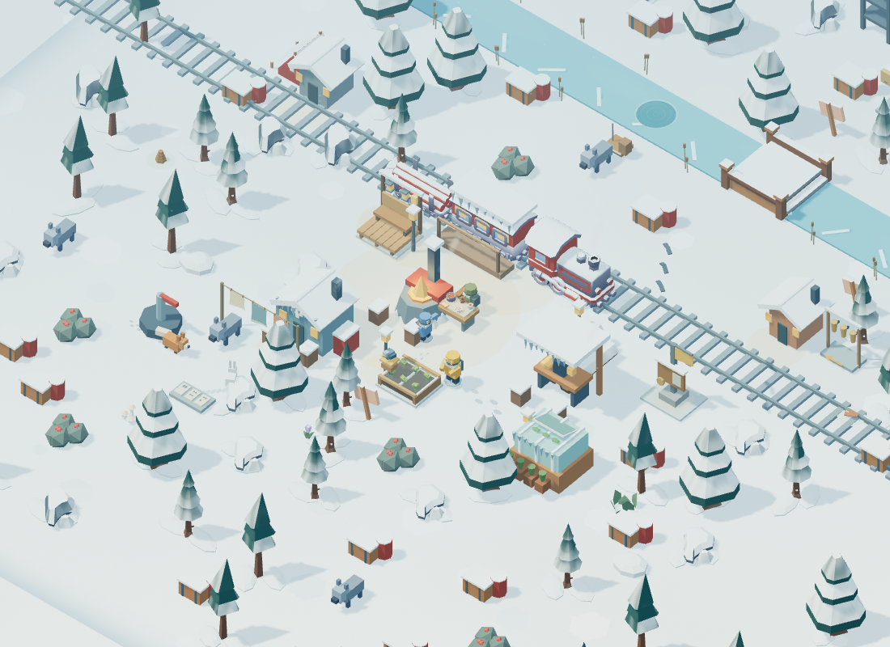
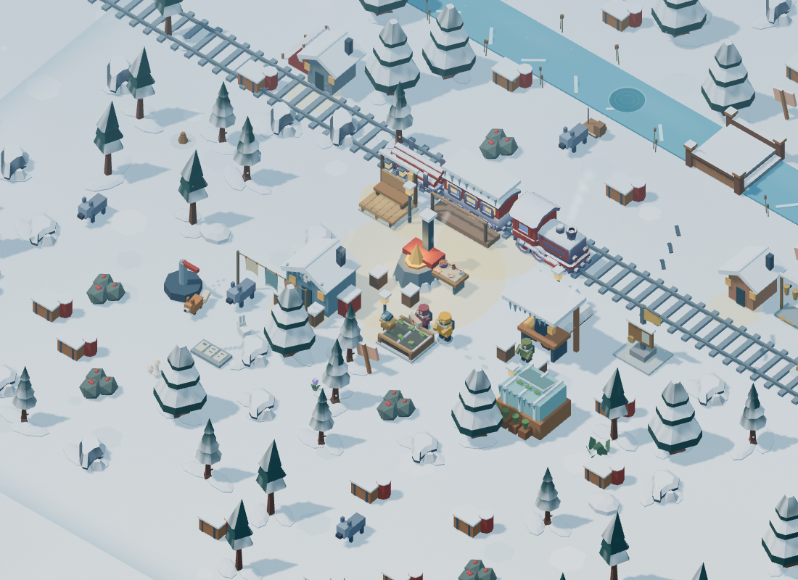
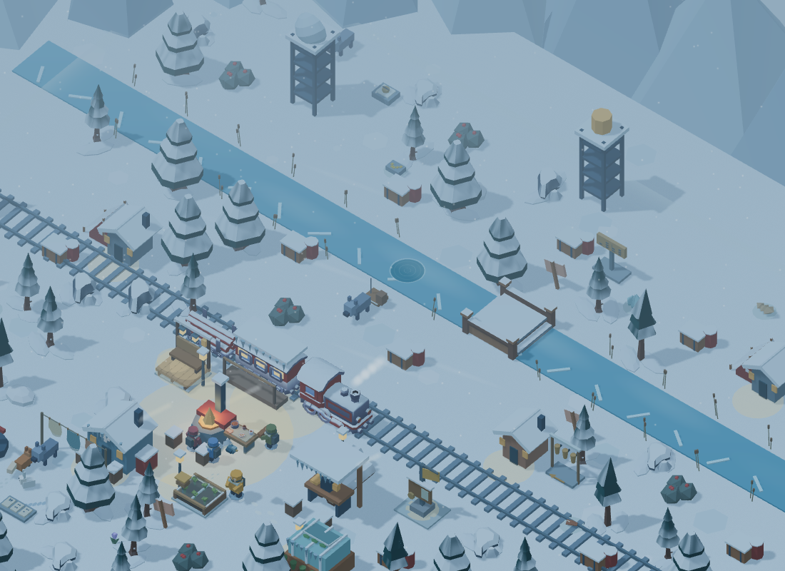
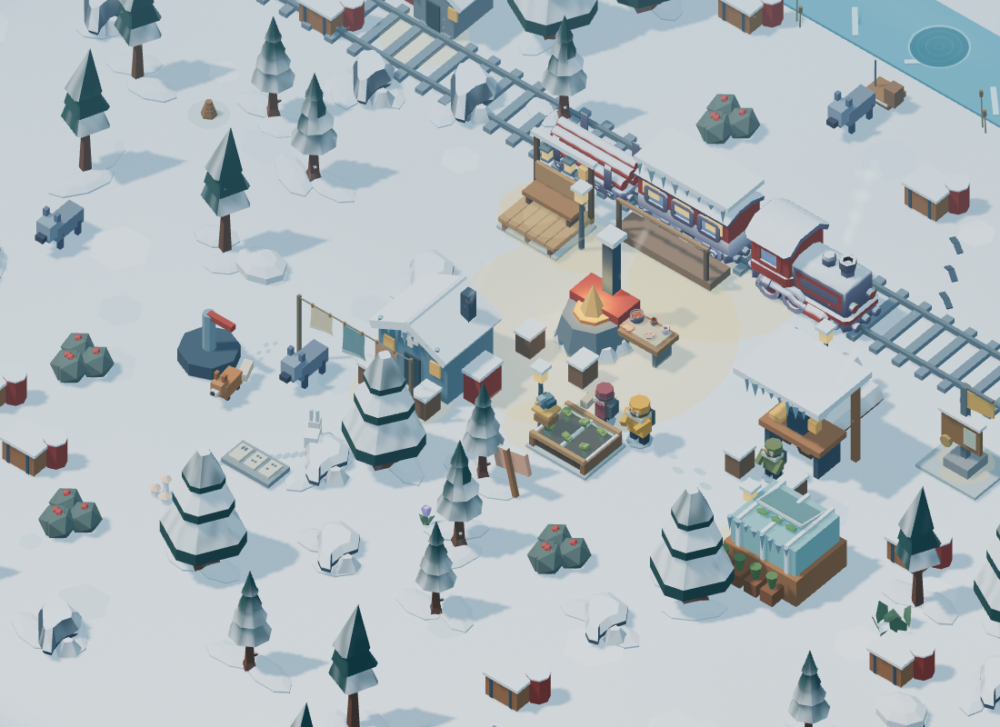

# Living Snow

This historical milestone is included in the newer [Valley Neighbours preview](VALLEY-NEIGHBOURS.md).

Twenty further visual improvements for Emberline's source/browser preview, 2026-10-23. Everything takes place in the same permanent Frosthollow valley. No APK was built, signed or released. Existing drag movement, exploration, gathering, progression, saves and all earlier additions remain.

## The twenty improvements

| # | Improvement | Visible behavior |
|---|---|---|
| 1 | Textured snow | Fine grain and broad wind-carved ripples break up the flat ground colour. The pattern stays fixed to the world while the camera moves. |
| 2 | Sculpted snow skirts | Rounded drifts gather at the bases of trees and resource rocks. They follow exploration and stock visibility and never block walking. |
| 3 | Roof icicles | Uneven, faceted ice hangs from the coach and restored infirmary, workshop and greenhouse eaves. |
| 4 | Moving cloud shadows | Broad, soft shadows drift over the snow, becoming weaker at night and in storms. Battery saver omits them. |
| 5 | Golden-hour light | Sunrise and evening add a gentle warm light to the existing blue winter palette. Steady daylight disables the transition. |
| 6 | Creek mist | Small, translucent banks of mist drift along explored portions of the creek. Storms strengthen them. |
| 7 | Ground spindrift | Short streaks of wind-blown powder cross nearby explored snow; gusts become stronger in storms. |
| 8 | Reeds and seedheads | Dry, grouped reeds line the creek banks and bend in the wind. The bridge and fishing access remain clear. |
| 9 | Branch-snow showers | Striking a tree dislodges small showers from its crown. A cooldown prevents every tool contact from flooding the view. |
| 10 | Footstep powder | Walking kicks up brief soft powder puffs. Timber rails, the creek and bridge do not produce snow puffs. Existing footprints remain. |
| 11 | Visible breath | Ash, rescued crew and the companion occasionally exhale small clouds that rise and dissolve. |
| 12 | Animated scarves | Coloured, woven scarf tails move with the wind. Ash's scarf trails farther while walking. |
| 13 | Hand-warming idles | After standing for a while, Ash briefly brings both hands together. Walking or gathering immediately takes priority. |
| 14 | Eased turns and lean | Ash turns along the shortest arc with a small body lean. This only changes the rendered character; movement and camera logic remain unchanged. |
| 15 | Crew greetings | Nearby free crew briefly face Ash and wave. Assigned work, hammering and walking take priority; a cooldown prevents repeated waves. |
| 16 | Linen clothesline | Restoring the infirmary adds hanging linen with woven hems, pegs and wind animation beside the building. |
| 17 | Hanging porch lamps | Completing the gathering porch adds two warm suspended lamps that sway gently with the wind. |
| 18 | Workshop sparks | Oren's hammering at the restored workshop produces tiny, short-lived warm sparks. This also works during his assigned camp job. |
| 19 | Greenhouse ventilation | The restored greenhouse gains a hinged vent that opens more during clear daylight and settles toward closed at night or in storms. Higher levels show a little moving greenery beneath it. |
| 20 | Feeder visits | Pip now approaches, lands, pecks, departs and circles back at a placed bird feeder, with articulated wings. Moving or removing the feeder uses the existing decoration system. |

## Presentation and performance

These are original procedural graphics authored for Emberline. The existing 26 bundled models remain; no new models or textures need downloading. Snow/cloud and textile shaders, simple meshes and the existing local particle mask provide the added art. [Source provenance](../web/assets/living-snow-provenance.json) records the implementation files and hashes; [notices](../THIRD-PARTY-NOTICES.md) preserve existing third-party asset terms.

Snow skirts, icicles and reeds use instanced geometry. A shared, fixed pool holds at most 128 new particles in Balanced mode and 32 in Battery saver. Mist and spindrift have fixed six/eight-element pools; nothing accumulates indefinitely. Battery saver also hides mist and spindrift. These limits bound the additions, not the entire existing renderer's cost.

Reduced motion keeps cloth, reeds and suspended lights still, omits the new drifting particles and greetings, and makes turns immediate. Photo mode freezes the new animation. App pause stops it through the existing lifecycle hook. Decorative animation has no rewards, timers or stored progress; closing the game cannot generate resources.

The update does not add save fields, internet requests, permissions, advertisements, accounts or purchases. The train and world coordinates remain unchanged. All unlocking continues through play and the existing restoration systems.

## Validation

All **58 model/asset test groups** and **nine browser suites** passed during this pass: general UI, play feel, freedom, living valley, overlapping selection, art/audio, Hearth & Horizon, Small Wonders and Living Snow. The final arm-rig changes were rechecked with the new animation suite and the real movement/gathering suites. No JavaScript errors or external runtime requests were observed.

The automated checks cover shader startup, earned visibility, fixed particle capacity and expiry, unchanged serialized gameplay state during cosmetic updates, stable geometry/texture allocations, crew priority rules, feeder transitions, sunrise/storm behavior, photo freeze, reduced motion, Battery saver and disconnected operation after local asset loading. A portrait capture also checks that actual scenery pixels are present after resizing the canvas.

Screenshots below come from the actual local WebGL renderer and the real clean-photo controls. Upgrades, explored terrain and time-of-day are supplied visual fixtures. They demonstrate the art, not a complete playthrough. Model tests separately cover ordinary progression and save compatibility. Detailed test results accompany the source milestone in the output validation report.

Browser tests use desktop Chrome with SwiftShader. No Android emulator or physical Galaxy S24 Ultra test was performed for this pass, so sustained phone frame rate, battery consumption and device-specific graphics remain unverified. The native wrapper was not changed or compiled.

The published 0.2.0 APK remains unchanged: 3,067,448 bytes; SHA-256 `fe7d6e8a1df895fc36f091d2beb082049b264591c2ecf054aa405650615221cf`.

