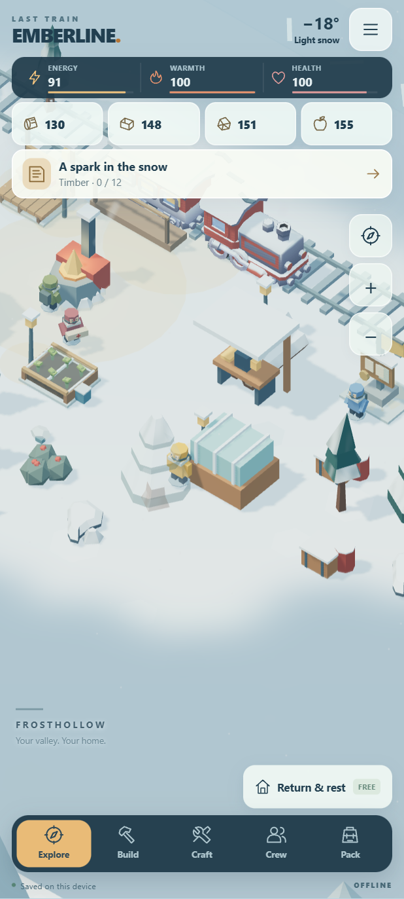
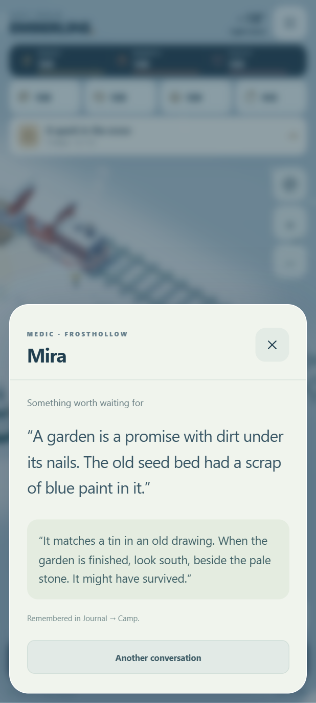

# Living valley preview

Source-only development update, 2026-10-23, on `feature/play-feel`. **No APK has been built, signed, or released for this update.** The published 0.2.0 APK is unchanged. The package version and save format remain unchanged; the preview identifies itself as “LIVING VALLEY PREVIEW” in Settings.

## Playing this update

Tap open snow to walk, drag to pan, pinch or use +/− to zoom, and use the compass to follow the explorer. The joystick, its handlers, side preference, and help text have been removed. Keyboard WASD and arrows remain available in the browser.

Movement banners no longer change the camera's viewport. Changes needed for an interaction card ease into place. Cancelling movement settles to the nearer tile instead of always pulling back to the start of a step; replacing a save discards the old step completely.

Foreground pines fade smoothly when their actual geometry blocks the explorer's head or shoulders. The current gathering tree also fades. A short hold avoids flicker as branches sway. Each affected tree has isolated material copies, which are restored and disposed when the view clears. Other instances keep their original opacity. Both graphics settings use this feature.

Mira tends supplies and the garden, Oren mends tools and checks the porch, and Ivo updates maps and the signal. Each has travel, work, and time by the hearth. Routes follow the clear camp lanes, close without teleporting, and use active play time. Menus and application pause stop the routines. Completed projects change the crew's activity descriptions, and storms change their hearth remarks.

Talk through Crew or tap a resident or companion in the world. Nine original conversation topics offer eighteen responses across rescue, restoration, and discovery milestones. Replies are remembered in Journal → Camp and can be revisited. Conversation choices have no resource cost, farmable reward, or irreversible gameplay penalty.

## Restorations and discoveries

| Project | Needs | Three visible stages | Hidden discovery |
| --- | --- | --- | --- |
| Winter garden | Mira and Greenhouse level 1 | Cleared bed, cold frame, shoots | Blue seed tin; a permanent garden keepsake |
| Gathering porch | Oren and Workshop level 1 | Braced platform, seats, lantern | Wooden toy engine; displayed on the porch |
| Valley signal post | Ivo and Locomotive level 1 | Straight post, mechanism and board, pennant | Ordinary-day letter; displayed with a reply |

Use Build → Visit the work site, then complete each stage at the site with gathered or crafted supplies. No real-world timers or purchases are involved. Completion reveals a clue; walking within two tiles reveals the nearby discovery's glint. Searching costs three energy and grants supplies once. Journal → Camp keeps clues, finds, and conversations. The existing eight keepsakes and final vault remain a separate collection.

All six new world nodes are appended after the original generation. A regression hashes the original world to preserve every resource ID, position, seed, and stock definition. New progress fields are optional when loading older saves. A character standing on a newly introduced project tile keeps that position and can walk out.

The train stays in its original location. There are no new zones, network services, permissions, dependencies, downloadable assets, or economy resets. New scenery meshes and writing are original project content; existing bundled CC0 models and licenses are unchanged.

## Validation

Run `npm test` and, with `node scripts/serve.mjs` running, the browser scripts listed in the README. The living-valley UI suite supplies crew, building levels, and inventory to focus on the new interactions. It completes all nine restoration stages through the UI. Discovery approach uses normal model movement as a fixture, then actual touch selection and searching. The campaign/economy suite separately covers all 16 milestones, eight original keepsakes, the vault, and 100 repeat contracts.

Validation on 2026-10-23: all **24 rules/save/asset groups** and **seven browser suites** passed (smoke, touch flow, replay UI, startup, art/audio, play feel, living valley). No uncaught errors or external requests were reported by suites collecting them. Tests covered portrait and landscape layouts, actual touch interaction, paused routines, old-save migration, import during movement, all nine project stages, one-time discoveries, and fading with both quality settings. In the recorded tap-walk test the viewport remained constant and the maximum projected camera change between samples was 5.60 CSS pixels; this is a regression observation, not a phone frame-rate benchmark.

The existing APK's SHA-256 remains `fe7d6e8a1df895fc36f091d2beb082049b264591c2ecf054aa405650615221cf` (3,067,448 bytes).

These are local source/browser checks, not new Android emulator or physical Galaxy S24 Ultra tests. Phone performance and comfort still need evaluation when an APK is requested.

## Suggested next improvements

1. A nearby-object chooser for crowded scenes, with clear labels and a comfortable one-handed reach.
2. A short introductory trail that teaches gathering, resting, and the first restoration through play, with less help-panel reading.
3. More earned visual changes: named garden beds, chosen porch decorations, and crew-specific finishing touches.
4. Optional challenge rules for repeat outings in this valley, with clear rewards and the ability to change back without losing the settlement.

Before adding more systems, play the tap controls and repeated gathering for a longer session. That will help tune camera distance, pacing, and touch targets.
