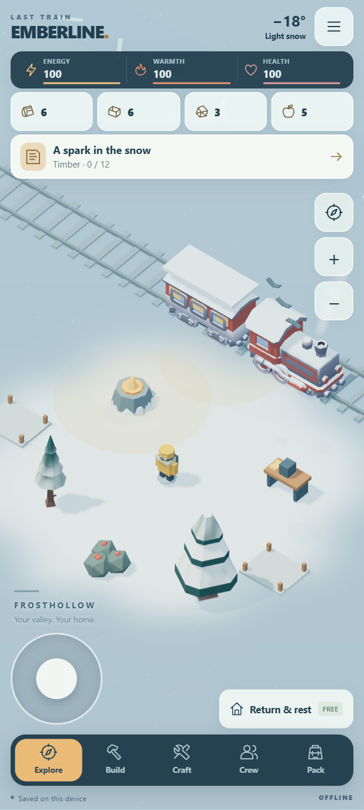
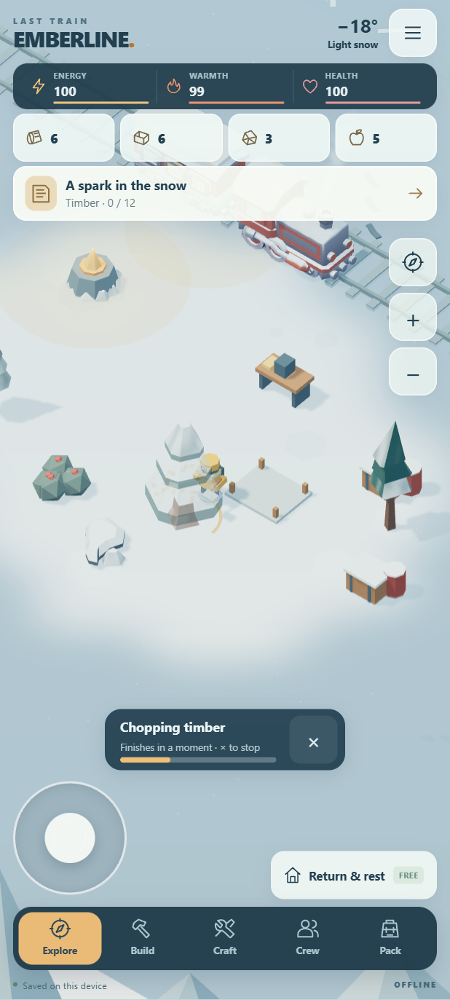

# Camera, controls and gathering preview

Historical milestone at `fd16445`. The subsequent [living valley preview](LIVING-VALLEY.md) removes the joystick, updates camera framing and completes the first three follow-up ideas below. Use its current test commands; joystick-specific commands in this historical record apply to that earlier commit.

Unreleased source update, 2026-10-23. **No APK build or new Android release.** The published 0.2.0 APK is unchanged. This remains one permanent valley with local saves, bundled assets and no purchases or runtime services.

## Changes

- Compact exploration HUD: the quest card ends around 202 CSS pixels from the top at the standard portrait size, leaving more space for scenery. Camera buttons, resource buttons and rest controls retain at least 44-pixel touch targets.
- Camera follow uses the explorer's actual position without the old distance-dependent drift. Near the train, a small framing offset includes more of home. Selections and work are framed in the clear area between the HUD and action controls. Landscape projection keeps the scenery large enough to read.
- Smooth +/− zoom, mouse wheel zoom and anchored two-finger pinch. Panning and pinching disengage follow; the compass restores it. Pinch release cannot turn into a walk or object selection. Zoom is saved with bounds of 16–34.
- Left- or right-thumb joystick placement, a smaller dead zone, stable keyboard direction tracking and release on menu opening, focus loss, pointer cancellation or capture loss. A held key cannot resume walking through keyboard repeat after a menu closes.
- A dotted walking route and pulsing destination marker. Routes clear on arrival or cancellation.
- Gathering uses three timed strikes within the existing 1.2-second work duration. Timber uses an axe, coal a pick, salvage a prybar, and berries bare hands. Material-specific sounds and particles accompany strikes; targets recoil gently.
- A progress meter and a ground arc show work advancing. The tree being chopped temporarily fades so the explorer and tool are visible; only that instance's materials change, and copies are disposed when work ends.
- Completed gathering produces a resource floater and inventory pulse. Stock, rewards and energy costs are still committed once by the existing model. Cancellation grants no harvest and stale timers cannot reopen a cancelled interaction.
- Visible model surfaces take priority over invisible enlarged touch areas. This fixes a nearby tree intercepting a tap on the visible salvage barrel beside it.

Older saves receive default camera and control preferences while preserving their settlement. No new art dependency, server, native permission or save-version change is introduced.

## Local preview and checks

Start `node scripts/serve.mjs` and open the printed loopback URL. The development Settings panel identifies this as the play feel preview. Browser progress is separate from Android app progress; exported saves can be imported through Settings.

Run `npm test`, then `node tests/play-feel.mjs` with the preview server running. Also run the existing browser smoke, touch flow, joystick, replay UI, startup and art/audio scripts listed in the README. The new tests cover real Chromium multi-touch, camera framing, saved preferences, all four gathering types, cancellation and portrait/landscape handed layouts. Test fixtures move the explorer near resources; these checks are not an end-to-end campaign playthrough.

This update has no new Android emulator or physical-phone validation because no APK was built. WebView/device performance, thumb feel and speaker mix need checking when a future APK is requested. The 0.2.0 Android validation record describes that released build only.

Validation on 2026-10-23: all 18 rules/save/asset test groups and all seven browser suites passed in local Chrome with software WebGL. Portrait widths of 360, 412 and 480 pixels and a 915×412 landscape layout were checked. The dedicated play-feel suite verifies both joystick sides, real multi-touch input, three strikes and one reward for each resource type, cancellation without a reward, saved preferences and framing away from camp. Captures were visually reviewed. No external resource requests or uncaught JavaScript errors were reported by the suites that collect them. The source-only update was not packaged or signed for Android.

## Suggested next work

1. Improve visibility around tall scenery: automatic fading for foreground trees that obscure the explorer, plus a nearby-interaction picker for heavily obscured objects.
2. Give crew distinct work and rest routines with short conversations responding to restored buildings and discovered keepsakes.
3. Add permanent restoration projects in the existing valley: a thawed garden, repaired signal house and recovered workshop, each with visual stages and small secrets.
4. Introduce optional specialization choices and repeatable challenge modifiers with equivalent access to story content and rewards. Avoid irreversible traps or paid shortcuts.

Prioritize a short phone playtest of this camera/control pass before expanding the economy or story. That will reveal whether the closer framing, joystick response and repeated gathering remain comfortable in longer sessions.
