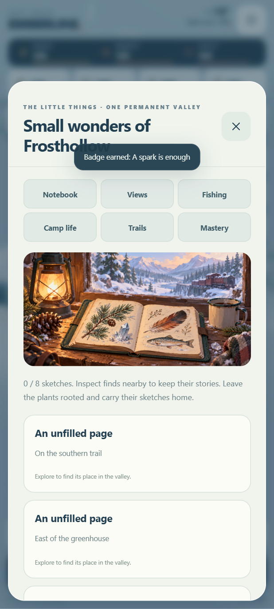
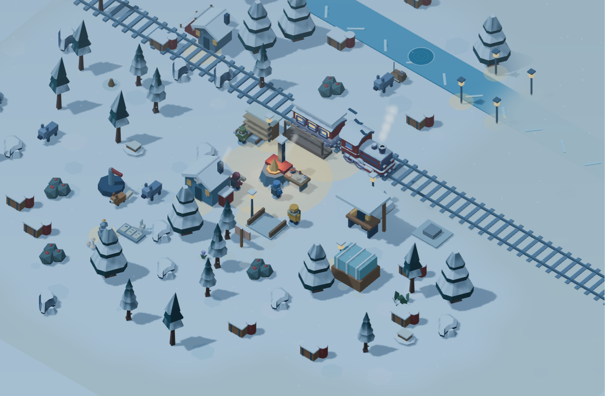

# Small Wonders of Frosthollow

Historical source milestone: `7de8fee329fbb90330f1389f7013443984141d0d`. These additions remain included in the newer [Living Snow preview](LIVING-SNOW.md).

Twenty additions to the source/browser preview, 2026-10-23. Everything remains offline in the same permanent valley. No APK was built, signed or released. Existing saves, native package/signing identity, drag movement and earlier content are retained.

Open the forecast button, then **Open the valley notebook**. Its six tabs group the activities. Crew also links to camp life, and Settings → Comfort opens the sound mixer. These additions use existing interaction sheets rather than adding more HUD cards.

## All twenty additions

| # | Addition | What is playable or visible |
|---|---|---|
| 1 | Illustrated naturalist notebook | Eight small finds across the valley, each with a local model, written clue and permanent entry. Inspect within two paces. Each first entry grants one part; repeat views pay nothing. Plants remain in place. An original illustrated notebook header is bundled locally. |
| 2 | Scenic viewpoints | Pinewatch, Sunward rise and Stillwater ridge offer three observations of the existing valley. Approach and record each; its trail box supplies two food once. Hidden views do not expose coordinates before exploration. |
| 3 | Relaxed fishing | Make a rod at the restored workshop for two planks and two salvage. At the Stillwater nook, follow three written float cues with Wait, Ease the line or Reel gently. No reaction timer, bait fee or failure penalty. A catch supplies three food; the pool recovers after 60 seconds of active play. |
| 4 | Fish journal | Four species, descriptions and saved catch counts. Successful casts cycle through species, so completing the collection requires no rare random luck. Partial casts survive saving; release them freely. |
| 5 | Collection cabinet | After three notebook finds, build a cabinet at camp for six planks and three parts. Coloured specimens fill its shelves as the notebook grows. |
| 6 | Gathering mastery | Timber, salvage, coal and food each offer one-time rewards at 30, 90 and 180 gathered. Prior gathering counts. Tiers give 2/3/4 parts and two food; no tool durability or changed harvest costs. |
| 7 | Optional crew jobs | Mira prepares medkits, Oren planks and Ivo parts. Each rescued friend needs a restored workstation and supplied ingredients. Jobs take 120–150 seconds of active play and require collection at camp. Cancel for a full ingredient refund; refunded jobs cannot also pay rewards. Working friends cannot join as companions. |
| 8 | Campfire stories | Three original stories unlocked by crew rescue and the restored hearth. Listen at camp at any time of day; remembered stories remain readable. No consumable gifts or relationship decay. |
| 9 | Train radio archive | Repair the existing relay to unlock four fictional recordings at camp. Every heard message remains readable. These are local story entries, never live radio, online messages or new destinations. |
| 10 | Salvage exchange | Three fixed workshop conversions turn surplus supplies into coal, timber or salvage. Costs are shown before each action. Requires being at camp with a restored workshop. |
| 11 | Trail sign repairs | Repair three weathered signs in place with three timber and one salvage each. Repaired signs stand upright and can mark home without moving the player. |
| 12 | Bridge lanterns | Prepare four lamps at camp after repairing the bridge. Four parts and three coal pay the one-time cost; no fuel upkeep. |
| 13 | Viewpoint benches | Three planks and two salvage add a bench at a discovered viewpoint. A breather restores up to 25 energy and warmth, then recovers for 90 seconds of active play. Free rest at home remains available. |
| 14 | Home whistle | Sound an original synthesized whistle at camp. Nearby crew turn toward the train briefly. Cosmetic, with a short active-play cooldown and no resource cost. |
| 15 | Aurora | A subtle ribbon above the northern ridge appears on clear moonlit nights. It pauses in photo mode, stays still under Reduced motion and is omitted in Battery saver. No timed rewards depend on it. |
| 16 | Ice and ripples | The fishing nook has an open pool, shimmering ice edge and bounded ripple rings. Photo mode pauses these details; Reduced motion keeps them still. |
| 17 | Wildlife tracks | Small fox and bird tracks follow familiar routes through explored snow. A fixed instance pool bounds their cost; cosmetic tracks do not grow the save. |
| 18 | River and bird ambience | Filtered-water synthesis increases near the creek. Local bird calls fade with distance and stop during storms. All audio is synthesized locally. |
| 19 | Sound mixer | Independent music, ambience and effects sliders save locally. Master mute and the music switch retain priority. A gentle whistle previews effects volume. |
| 20 | Explored-route previews | Map waypoints show dotted routes through known passable tiles only. Unknown terrain and blocked crossings reveal no shortcuts. The preview never moves the explorer; drag to walk. |

## Assets and rights

Ten models were selected from [Kenney Food Kit](https://kenney.nl/assets/food-kit) and [Kenney Nature Kit](https://kenney.nl/assets/nature-kit), whose official pages and downloaded license files identify CC0. This subset contains six food/table props, a flower, mushroom cluster, fern-like leaves and sign. Exact archive/file hashes, palette dependencies and scene-root repairs are in [the asset manifest](../web/assets/field-assets.json). All ten passed glTF Validator with zero errors/warnings; [full reports](../web/assets/field-validation.json) are retained. Only selected files were checked, not entire packs. Runtime shading preserves plant colours and gives mushroom caps a lighter snow coating.

The [original notebook illustration](../web/assets/notebook.png) was made with the built-in `image_gen` tool and copied into the project. Its [complete production prompt](../web/assets/notebook-prompt.json) describes a painterly notebook, lantern, pine sprig, crystal, feather and fish sketch overlooking the snowy train home. This decorative artwork is separate from CC0 model licensing. [Third-party notices](../THIRD-PARTY-NOTICES.md) preserve those distinctions.

No engine migration, new runtime dependency, permission, account, service or runtime download was added. All art and audio code live in the source repository; authoring tools are not part of the game.

## Saves and timing

Save format 1 remains. Older saves gain an empty optional `field` extension and default mix levels. Original resource IDs and coordinates are unchanged. Fifteen interaction sites are appended without blocking existing paths. Imported lists, counts, jobs, cooldowns and sliders are bounded to recognized values.

Jobs, pool recovery, benches and the whistle use `activeSeconds`. Menus, application pause, photo mode and closing the game stop their timers. There is no wall-clock catch-up or daily schedule. Progress rewards require explicit actions and cannot be duplicated by repeating a finished action.

## Validation

Completed checks and device limitations are recorded with the source milestone below. Screenshots use supplied inventory and infrastructure to inspect additions; legal model walks and real interface actions earn the recorded notebook, fishing and camp progress. They are not a full phone playthrough.

- All **55 model/asset test groups** passed, including the original campaign, 100 repeatable contracts, original-node fingerprints, all fifteen new sites, eight observations, three viewpoints/benches, four fish, twelve mastery tiers, job payment/refund rules, archive gates, imported-data bounds and explored-only routes.
- **Eleven browser suites** passed: general UI, touch flow, replay UI, startup recovery, art/audio, play feel, living valley, overlapping selection, freedom, Hearth & Horizon, and Small Wonders. The new suite exercises the actual nearby-object picker, notebook entries, fishing cues, cabinet, sign, bench, lamps, jobs, stories, messages, exchanges, whistle, mixer, save reload and local gameplay after asset loading with networking disconnected. No external runtime requests or JavaScript errors were observed.
- Every newly adopted model was rendered in the game and a separate inspection sheet. Plant colour, fish orientation, the camp layout, aurora and portrait/landscape interfaces were inspected. The landscape map's full canvas and enclosing frame are checked against cropping.
- Missing-model injection still leaves a playable fallback. Existing drag/pinch/release/cancel controls, gathering, photo pause and Android lifecycle hooks pass browser checks. The native wrapper was not changed or compiled in this pass.
- No emulator or physical Galaxy S24 Ultra playtest was performed. Sustained phone performance, audible mix, haptics and thumb ergonomics remain to be checked on a future authorized APK.

The published 0.2.0 APK is unchanged: 3,067,448 bytes, SHA-256 `fe7d6e8a1df895fc36f091d2beb082049b264591c2ecf054aa405650615221cf`. These twenty additions are available in the source/browser preview only.

