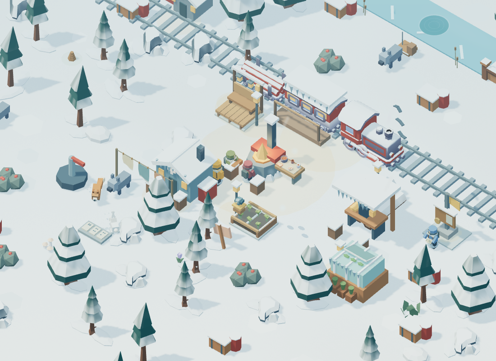
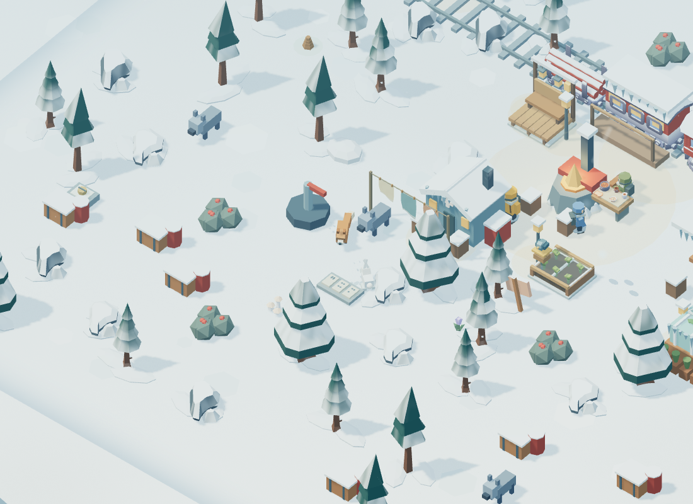
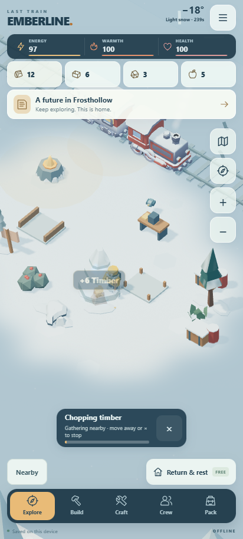

# Valley Neighbours

Twenty further character and wildlife improvements, plus Sean's requested automatic gathering. Source/browser milestone for Emberline, 2026-10-23. All play remains offline in the same permanent Frosthollow valley. No APK was built, signed or released.

## The twenty additions

| # | Improvement | What you will see |
|---|---|---|
| 1 | Articulated legs and boots | Ash, the three residents and the companion now have hip, knee and ankle joints with visible boot shapes. Knees fold during a step. |
| 2 | Strides that follow movement | Stride phase follows distance actually travelled. Walking eases in and out, so a stopped character does not keep running on the spot. |
| 3 | Backpack movement | Packs bounce and tilt a little behind the walking rhythm; visible shoulder straps tie them into the coat silhouette. |
| 4 | Staggered blinking | Characters blink at different intervals instead of sharing a synchronized expression. |
| 5 | Head glances | Ash looks toward a work target or a nearby friend; residents and the companion glance toward a nearby Ash. Head turns are bounded and eased. |
| 6 | Full-body tool swings | Anticipation, torso twist, knee bracing and recovery follow the existing three harvest contacts. Moving during automatic gathering keeps the walking stride. |
| 7 | Berry-picking pose | Stationary foraging crouches and reaches with an empty hand rather than using the tool animation. |
| 8 | Brushing snow from a shoulder | A longer idle occasionally brushes a shoulder. Hand warming, moving and gathering take priority. |
| 9 | Independent companion gait | The companion's steps and facing follow its own catch-up movement, including when Ash has already stopped. |
| 10 | Mira's medical supplies | At her medical routine or assigned job, Mira holds a small marked kit and checks a roll of bandage. |
| 11 | Oren's carpenter's hammer | Oren now holds a hammer, faces his work surface and brings it down in time with the existing workshop effect. |
| 12 | Ivo's folding map | Survey stops show a two-panel paper map. Ivo opens it, looks down, then looks up again. |
| 13 | Tea breaks | Resting residents hold handled mugs and periodically raise them to sip. Walking, greetings and assigned chores supersede the gesture. |
| 14 | Ember's articulated trot | The fox has moving leg joints, a flexible tail, head, ears and blinking eyes, instead of sliding around its old route. |
| 15 | Fox foraging | Ember alternates a short local trot with sniffing and a small snow pounce, then returns to the resting spot. |
| 16 | Fox rest and attention | Ember folds its legs and wraps its tail to rest, settles longer at night, and watches a nearby player. Leaving lets the routine resume. |
| 17 | Thimble's articulated hops | The hare gains forefeet, large hind feet, a small tail and ear pivots. Feet tuck and ears trail during each hop. |
| 18 | Hare grooming and listening | Thimble pauses to wash its face or listen with independently moving ears. Approaching makes it hold still and watch. |
| 19 | Pip's expressive head | The bird tilts its head, blinks and preens a shoulder while perched. Flight and pecking take priority over preening. |
| 20 | Tracks from actual animal travel | Fox paw marks and longer hare prints are laid down where the animals move and land. They fade into the snow, faster in storms, instead of following as a rigid ribbon. |

These extend the earlier [Living Snow](LIVING-SNOW.md) effects rather than replacing the weather, feeder flight, scarves, greetings, crew routines or restoration systems. The existing animal observation locations and rewards remain; wildlife is decorative and never consumes your supplies or blocks walking.

## Automatic gathering

Automatic gathering starts enabled, including for existing saves. Walk within about one and a half valley units of an explored tree, coal outcrop, salvage pile or berry bush. Ash uses the normal work cycle and harvest amount, repeats while stock remains, and stops before energy, warmth or health run low. The small range margin on an active target prevents switching between two resources at the edge of reach.

One-finger dragging and keyboard movement remain responsive during work. Leaving reach cancels the incomplete harvest without awarding loot or charging its cost. Pressing × stops work and keeps it stopped until you move away from that position. Menus, photo mode and app pause cannot finish a harvest. Settings → Comfort → Automatic gathering turns the feature off and saves that preference. Optional manual gathering and Gather remaining supplies remain available.

Automatic work only targets those four resource types. It does not fight wolves, spend construction supplies, rescue survivors, open discoveries, answer conversations, operate puzzles, steer the character or select a camera focus. Existing costs, finite stock, regrowth, equipment bonuses, quests and contract progress use the normal game rules.

## Art and performance

The rigs, held props, map panels, boots, straps and animation code were created for Emberline using the already-bundled renderer. No new runtime libraries, downloaded assets or external authoring services are required. The existing 26 local glTF models and their licenses remain. [Source provenance](../web/assets/inhabitants-provenance.json) records hashes for the new original assets; [notices](../THIRD-PARTY-NOTICES.md) preserve third-party terms.

Animal prints use one instanced mesh with a fixed 96-record pool, reduced to 32 visible records in Battery saver. They expire after 28 clear-weather seconds and sooner in storms. Reduced motion disables these tracks and the new secondary gestures, blinking, pack bounce and small wildlife motions. Photo mode freezes poses, wildlife clocks and track ages. Animation uses active renderer time, not a wall clock, and never writes progression or generates offline rewards.

The screenshots below are actual local WebGL renders. Completed buildings, explored terrain and selected times are explicit visual fixtures, not evidence of earning everything in a playthrough. Browser verification uses desktop Chrome/SwiftShader. Physical Galaxy S24 Ultra frame rate, battery use and device-specific rendering have not been tested for this source milestone.

## Validation

**All 65 model/asset tests and 11 browser suites passed.** The browser suites cover general UI, play feel, freedom, living valley, selection, art/audio, Hearth & Horizon, Small Wonders, Living Snow, Valley Neighbours and automatic gathering. Optional manual-gathering fixtures keep their exact strike/reward tests; the new automatic suite exercises the default mode, approaching and leaving with real touch gestures, and story progression. The detailed results accompany the source milestone report. Checks cover the new joint and behavior math, actual WebGL startup, crew pose priorities, wildlife phases, track expiry/capacity, unchanged saves during cosmetic animation, photo freeze, reduced motion, stable GPU allocations after prop upload, real touch movement during automatic work, normal harvest quantities, cancellation, menu/app pause, settings persistence and disconnected gameplay after local loading.

The published 0.2.0 APK remains unchanged: 3,067,448 bytes; SHA-256 `fe7d6e8a1df895fc36f091d2beb082049b264591c2ecf054aa405650615221cf`.
