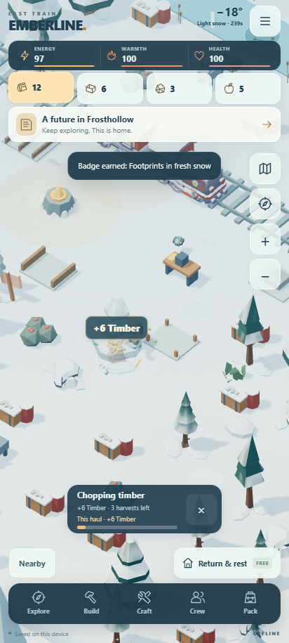
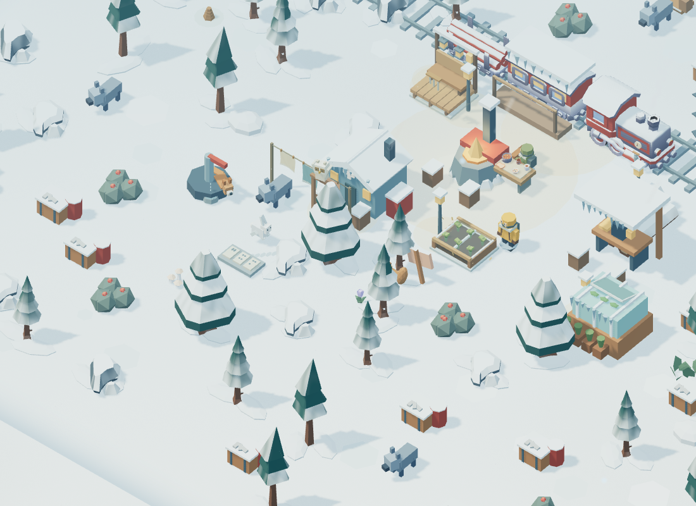

# Valley Rhythms

Fifty additional improvements to Emberline's source/browser preview, 2026-10-23. All play remains fully offline in the same permanent Frosthollow valley. **No APK was built, signed or released.**

## Gathering — 18 additions

| # | Implemented improvement | Where to see it |
|---|---|---|
| 1 | A subtle approach halo identifies the closest explored resource before work begins. | Walk within 2.6 paces of supplies. |
| 2 | Three raised contact markers accompany the existing progress arc. | Each marker lights at its actual strike beat. |
| 3 | Ground-level stock beads show remaining harvests. | Up to four beads beside the nearby resource. |
| 4 | The work card previews the exact next yield, including earned equipment and crew bonuses. | Beside the remaining-harvest count. |
| 5 | A cumulative haul receipt groups earned timber, coal, salvage and food. | During work and for 20 active seconds afterward. |
| 6 | Nearby safety hints explain low energy, warmth or health that prevents automatic work. | Approach supplies with low vitals. |
| 7 | Depleted resources show their remaining recovery time in active play seconds. | Stand nearby; resting also replenishes them. |
| 8 | Partial timber harvests leave visible bark notches. | Inspect a pine after one or more harvests. |
| 9 | Exhausted pines leave a small stack of cut logs. | Deplete a pine. |
| 10 | Coal outcrops acquire pale fracture lines as stock falls. | Mine successive harvests. |
| 11 | Loose metal pieces disappear from salvage crates as they are collected. | Compare a full and depleted crate. |
| 12 | Ripe berry clusters thin with actual remaining stock. | Pick successive harvests. |
| 13 | Replenished resources unfold smoothly from their depleted form. | Let an exhausted resource recover or rest. |
| 14 | Directional wooden chips fly from each axe contact. | Chop timber; chips aim toward the working side. |
| 15 | Coal grit falls and bounces after pick contact. | Mine coal. |
| 16 | Metallic washer fragments spin and ricochet off salvage. | Use the prybar. |
| 17 | Light leaf fragments flutter from berry picking. | Pick winter berries. |
| 18 | Six bounded pitch variations and a three-hit emphasis pattern make repeated material sounds less uniform. | Gather with effects audio enabled. |

## Character animation — 16 additions

| # | Implemented improvement | Where to see it |
|---|---|---|
| 19 | All five human rigs gain articulated forearms, wrists and visible thumbed mittens. | Hero, crew and walking companion. |
| 20 | Axe work bends the supporting elbow into a two-handed brace. | Chop timber. |
| 21 | Pick work folds the raised elbow for an overhead stroke. | Mine coal. |
| 22 | Salvaging uses a sideways torso turn and bent-arm leverage. | Work a salvage crate. |
| 23 | Berry picking cups the receiving palm and briefly holds a berry. | Forage without a tool. |
| 24 | Wrists flex at the three actual contact points, adding follow-through to the existing body animation. | Watch any gathering cycle. |
| 25 | The final harvest can end with a brief pack-stowing reach. | Finish a node while stationary. |
| 26 | A small satisfied nod follows the final harvest. | Stay still after finishing. |
| 27 | Planted boots compress into soft snow during a stride. | Walk over snowy ground. |
| 28 | Idle torsos breathe subtly, with different phases per person. | Stop moving. |
| 29 | Bridge strides lift the knee and foot higher over the timber crossing. | Walk across the repaired northern bridge. |
| 30 | The hero shields their face with a bent arm during strong wind. | Walk or stand in a storm, outside gathering. |
| 31 | A resting companion occasionally points out nearby supplies. | Stop beside a resource with a companion. |
| 32 | A longer idle includes lifting and shaking snow from one boot. | Wait about 17 seconds. |
| 33 | Nearby resting crew take turns speaking with open-hand gestures. | Watch overlapping hearth breaks. |
| 34 | The other resting crew member turns to listen and nod. | The listening role changes with the speaker. |

## Valley life — 16 additions

| # | Implemented improvement | Where to see it |
|---|---|---|
| 35 | An original red squirrel scurries around the southern woodland. | Around the path west of the first pine. |
| 36 | The squirrel pauses to handle and nibble an acorn. | Watch its foraging break. |
| 37 | Approaching makes it retreat with a raised tail, then resume after you leave. | Walk near its patch. |
| 38 | A snow owl watches from a wooden perch, tilts its head and narrows its eyes by day. | Near the western woodland. |
| 39 | At dusk and night, the owl makes short wing-driven flights and returns to its perch. | Watch after dark. |
| 40 | Three fish silhouettes swim beneath the existing fishing opening. | Stillwater fishing nook. |
| 41 | Fish make localized expanding surface rings at intervals. | Watch the opening between fishing visits. |
| 42 | Gentle firefly lights hover near an established greenhouse at night. | Build the greenhouse and return after dark. |
| 43 | A locomotive pressure gauge has a moving needle reflecting engine upgrades. | On the front side of the stationary engine. |
| 44 | A low side valve periodically releases a short puff of steam. | Near the engine's front wheel. |
| 45 | A hanging three-tube chime sways independently in the wind. | Western porch area. |
| 46 | The repaired pump drips water into a small basin. | Repair the southwest pump. |
| 47 | Each pump drip is accompanied by a fading basin ripple. | Watch the basin. |
| 48 | Dry leaves tumble around the restored garden. | Complete its first restoration stage. |
| 49 | Existing wolves breathe and scan their surroundings with an articulated head. | Explored wolf sites; encounter rules stay the same. |
| 50 | Small pale moths flutter around the infirmary's warm porch after dark. | Build the infirmary. |

## Behavior and assets

Automatic gathering still uses the original 1.2-second action, three contacts, ordinary finite stock, energy costs, equipment bonuses and quest accounting. Dragging remains responsive during a swing. Leaving reach cancels unfinished work without charging or awarding anything. Cosmetic stowing and nodding yield immediately to movement or another harvest. Held movement is now cleared before importing a save, fixing a race in which the old held key could move the newly imported character.

New wildlife and camp details are cosmetic inhabitants of this same valley. Explored terrain and earned buildings control their visibility. Progress and saves use the existing format. No wall-clock rewards, paid content, external services, downloads or runtime dependencies were added.

All new meshes, animation, fragments and sound variations are original MIT project code. They use the existing bundled three.js runtime alongside the 26 previously bundled Kenney models and existing illustrations. Source hashes and fixed pool limits are in `web/assets/valley-rhythms-provenance.json`; earlier asset provenance is preserved. No third-party asset was newly adopted, so the shared resource catalog required no additions.

The four contact pools hold at most 32 fragments each (12 each in Battery saver). Fireflies, leaves and moth wings use fixed instancing. Reduced motion makes the new joint/creature poses static and hides transient effects. Photo mode freezes their clocks. The haul receipt lives only in memory, expires on active play time and cannot carry across imported saves.

## Validation

**72 model/asset tests and 12 browser suites passed.** Browser suites: general UI, play feel, freedom, living valley, selection, art/audio, Hearth & Horizon, Small Wonders, Living Snow, Valley Neighbours, automatic gathering and Valley Rhythms.

Validation includes pure tests for real-yield previews, resource hints, haul expiry/save isolation, audio variation, finishing poses and continuous local wildlife routes. Browser tests exercise actual WebGL stock stages, contacts and hand poses, crew social roles, wildlife reactions, daytime/nighttime gates, pump and engine details, reduced motion, photo freeze, low-quality caps, stable GPU allocations after warmup, unchanged saves during cosmetic animation, phone layout, and ordinary automatic harvests. Regression checks cover movement, cancellation, touch selection, camera behavior, restoration and existing art/audio.

Screenshots below are actual local WebGL captures. Completed buildings, explored terrain and selected times are disclosed visual fixtures, not a claim of earning all progression in those screenshots. Chrome/SwiftShader browser checks and disconnection after local loading do not establish native cold-start behavior or Galaxy S24 Ultra frame rate, battery use or audible mix. Those require the later device build/playtest.

The published 0.2.0 APK remains unchanged: 3,067,448 bytes; SHA-256 `fe7d6e8a1df895fc36f091d2beb082049b264591c2ecf054aa405650615221cf`.
